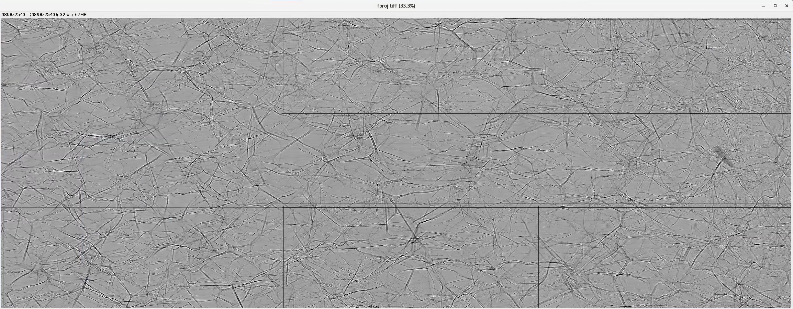
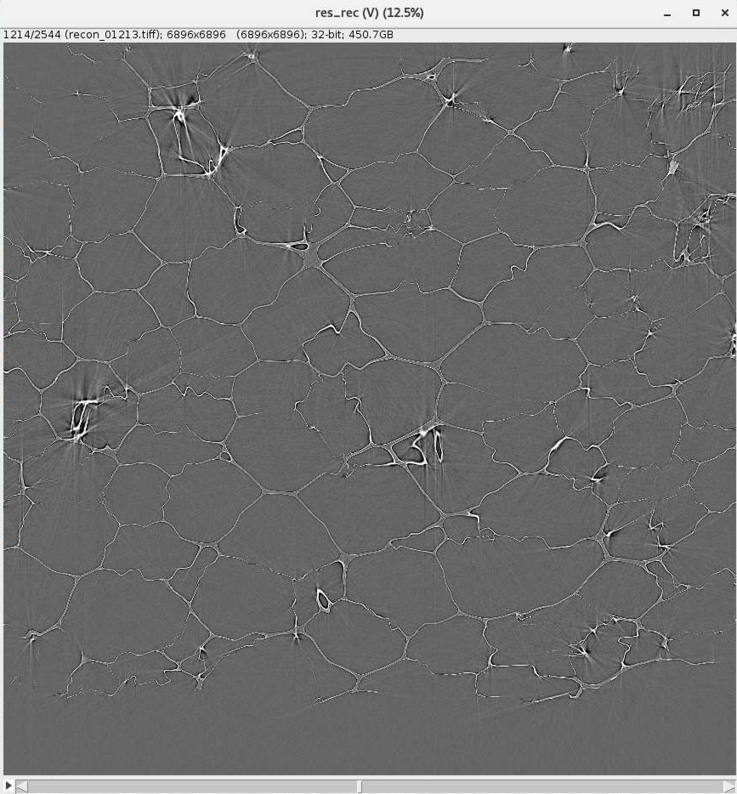
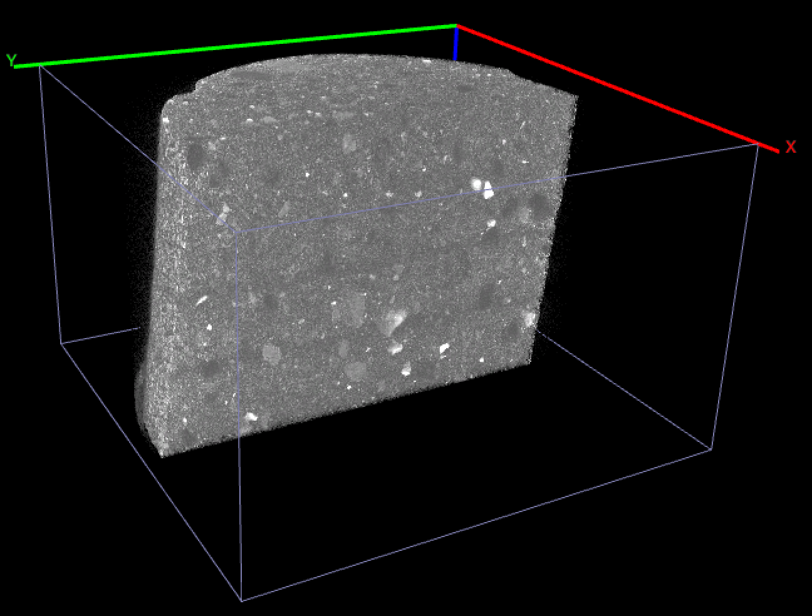
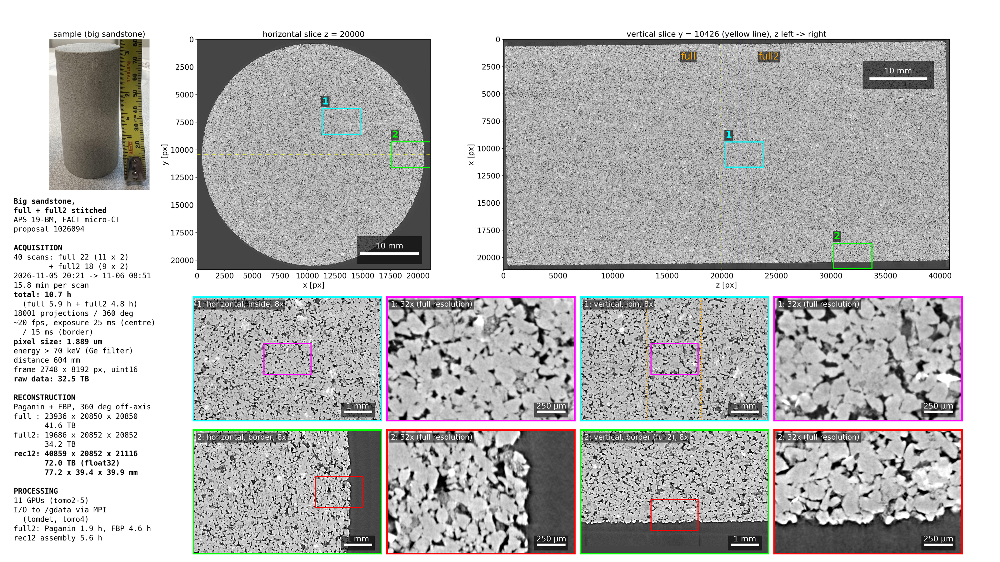

Mosaic
------

Foam
----

Foam is a 3 x 3 mosaic tomography data set used as a test data set during the development of 
`mosaic <https://github.com/xray-imaging/mosaic>`_, a command line inteface from mosaic tomography 
data processing.

Data sets were collected with the following mosaic parameters:

::

    image   size (x, y) in pixels: (2448, 900)
    mosaic shift (x, y) in pixels: (2202, 811)

+---------------------+------------------------------+-----------------------------+--------------------------------+
|   Tile location     |   X (h) tile position (mm)   |  Y (v) tile position (mm)   |  file name                     |
+=====================+==============================+=============================+================================+
|        x0y0         |      -3.800300;              |         15.000000           |      mosaic_test_001.h5        |
+---------------------+------------------------------+-----------------------------+--------------------------------+
|        x1y0         |      -0.000300;              |         15.000000           |      mosaic_test_002.h5        |
+---------------------+------------------------------+-----------------------------+--------------------------------+
|        x2y0         |       3.799700;              |         15.000000           |      mosaic_test_003.h5        |
+---------------------+------------------------------+-----------------------------+--------------------------------+
|        x0y1         |      -3.800300;              |         16.400000           |      mosaic_test_004.h5        |
+---------------------+------------------------------+-----------------------------+--------------------------------+
|        x1y1         |      -0.000300;              |         16.400000           |      mosaic_test_005.h5        |
+---------------------+------------------------------+-----------------------------+--------------------------------+
|        x2y1         |       3.799700;              |         16.400000           |      mosaic_test_006.h5        |
+---------------------+------------------------------+-----------------------------+--------------------------------+
|        x0y2         |      -3.800300;              |         17.800000           |      mosaic_test_007.h5        |
+---------------------+------------------------------+-----------------------------+--------------------------------+
|        x1y2         |      -0.000300;              |         17.800000           |      mosaic_test_008.h5        |
+---------------------+------------------------------+-----------------------------+--------------------------------+
|        x2y2         |       3.799700;              |         17.800000           |      mosaic_test_009.h5        |
+---------------------+------------------------------+-----------------------------+--------------------------------+

mosaic file name grid:

+------------+------------------------+---------------------------+-------------------------+
|            |         x_0            |             x_1           |          x_2            |
+============+========================+===========================+=========================+
|     y_0    |    mosaic_test_001.h5  |       mosaic_test_002.h5  |    mosaic_test_003.h5   |
+------------+------------------------+---------------------------+-------------------------+
|     y_1    |    mosaic_test_004.h5  |       mosaic_test_005.h5  |    mosaic_test_006.h5   |
+------------+------------------------+---------------------------+-------------------------+
|     y_2    |    mosaic_test_007.h5  |       mosaic_test_008.h5  |    mosaic_test_009.h5   |
+------------+------------------------+---------------------------+-------------------------+

Each data set is collected with the following parameters:

+-------------------------+----------------------------------------+-----------+
| tomo_ID                 |  00094                                 |           |  
+=========================+========================================+===========+
| Image preview           | |00094|                                |           |  
+-------------------------+----------------------------------------+-----------+
| Recon preview           | |00094_rec|                            |           |  
+-------------------------+----------------------------------------+-----------+
| Download                | tomo_00094_                            |           |  
+-------------------------+----------------------------------------+-----------+
| camera_distance         | 100.00000000000011                     | mm        |
+-------------------------+----------------------------------------+-----------+
| camera_objective        | 2x                                     |           |
+-------------------------+----------------------------------------+-----------+
| resolution              | 1.725                                  | microns   |
+-------------------------+----------------------------------------+-----------+
| scintillating_thickness | 50.0                                   | microns   |
+-------------------------+----------------------------------------+-----------+
| scintillator_type       | LuAG:Ce                                |           |
+-------------------------+----------------------------------------+-----------+
| size_x                  | 2448                                   |           |
+-------------------------+----------------------------------------+-----------+
| size_y                  | 900                                    |           |
+-------------------------+----------------------------------------+-----------+
| instrument_name         | Micro-tomography                       |           |
+-------------------------+----------------------------------------+-----------+
| energy                  | 25.51                                  | keV       |
+-------------------------+----------------------------------------+-----------+
| beamline                | 2-BM-A                                 |           |
+-------------------------+----------------------------------------+-----------+
| current                 | 102.038222190282                       | mA        |
+-------------------------+----------------------------------------+-----------+
| fill_mode               | 0+24x1                                 |           |
+-------------------------+----------------------------------------+-----------+
| source_name             | Advanced Photon Source                 |           |
+-------------------------+----------------------------------------+-----------+
| top_up                  | Enable                                 |           |
+-------------------------+----------------------------------------+-----------+
| description_2           | 25.51 kEv                              |           |
+-------------------------+----------------------------------------+-----------+
| description_3           | 100mm sample to detector off center    |           |
+-------------------------+----------------------------------------+-----------+
| title                   | mosaic_test                            |           |
+-------------------------+----------------------------------------+-----------+
| institution             | Advanced Photon Source                 |           |
+-------------------------+----------------------------------------+-----------+
| file_name               | mosaic_test                            |           |
+-------------------------+----------------------------------------+-----------+
| file_path               | /local/data/2021-09/Pasha/             |           |
+-------------------------+----------------------------------------+-----------+
| full_file_name          | mosaic_test_001.h5                     |           |
+-------------------------+----------------------------------------+-----------+
| sample_name             | test mosaic scan                       |           |
+-------------------------+----------------------------------------+-----------+
| num_dark_fields         | 40                                     |           |
+-------------------------+----------------------------------------+-----------+
| num_flat_fields         | 40                                     |           |
+-------------------------+----------------------------------------+-----------+
| sample_in_x             | -3.8                                   | mm        |
+-------------------------+----------------------------------------+-----------+
| sample_in_y             | 0.0                                    | mm        |
+-------------------------+----------------------------------------+-----------+
| sample_out_x            | 15.0                                   | mm        |
+-------------------------+----------------------------------------+-----------+
| sample_out_y            | 0.0                                    | mm        |
+-------------------------+----------------------------------------+-----------+
| num_angles              | 6000                                   |           |
+-------------------------+----------------------------------------+-----------+
| return_rotation         | Yes                                    |           |
+-------------------------+----------------------------------------+-----------+
| rotation_speed          | 0.19518786863429474                    | degrees/s |
+-------------------------+----------------------------------------+-----------+
| rotation_start          | 0.0                                    | degrees   |
+-------------------------+----------------------------------------+-----------+
| rotation_step           | 0.03000973466739211                    | degrees   |
+-------------------------+----------------------------------------+-----------+
| start_date              | 2021-09-27T16:51:55-0500               |           |
+-------------------------+----------------------------------------+-----------+
| end_date                | 2021-09-27T17:07:57-0500               |           |
+-------------------------+----------------------------------------+-----------+

.. _tomo_00094: https://app.globus.org/file-manager?origin_id=9f00a780-4aee-42a7-b7f4-6a2773c8da30&origin_path=%2Ftomo_00094%2F

Activated charcoal
~~~~~~~~~~~~~~~~~~

This dataset contains an activated charcoal sample that is approximately 4 mm in diameter. 
Since the sample extends beyond the field-of-view (FOV), the acquisition and reconstruction
were conducted using the Tomosaic protocol [ref]. A full dataset stitched from a 4 by 4 mosaic
tile grid is available here.

Tomosaic, the software used to for processing and reconstructing the mosaic dataset, is an
open-source project which can be found here: tomosaic_

Metadata files in the repository include:
  * `center_pos.txt`: Center axis positions for each of the 4 rows of tiles.
  * `shifts.txt`: Relative positions of all 16 tiles. The 6 columns in the file provide information

of: tile position y, tile position x, relative shift y to right neightbor, 
relative shift x to right neightbor, relative shift y to bottom neightbor, 
relative shift x to bottom neightbor.

.. _tomo_00078: https://app.globus.org/file-manager?origin_id=9f00a780-4aee-42a7-b7f4-6a2773c8da30&origin_path=%2F%2Ftomo_00078%2F

.. _tomosaic: https://github.com/mdw771/tomosaic2.git

+-----------------------------------------+----------------------------+
|             tomo_ID                     | 00078                      |  
+=========================================+============================+
|             Image preview               | |00078|                    |  
+-----------------------------------------+----------------------------+
|             Download                    | tomo_00078_                |  
+-----------------------------------------+----------------------------+
|             Instrument                  | APS 32-ID-C                |  
+-----------------------------------------+----------------------------+
|             Sample name                 | Charcoal                   |  
+-----------------------------------------+----------------------------+
|             X-ray energy                | 25.0 keV                   |  
+-----------------------------------------+----------------------------+
|             Sample-to-detector distance | 30 cm                      |  
+-----------------------------------------+----------------------------+
|             Scan Range                  | 180 degree                 |
+-----------------------------------------+----------------------------+
|             Number of Projections       | 4500                       |
+-----------------------------------------+----------------------------+
|             White Fields                | 50                         | 
+-----------------------------------------+----------------------------+
|             Dark Fields                 | 10                         |  
+-----------------------------------------+----------------------------+
|             Pixel size                  | 0.8 um                     |  
+-----------------------------------------+----------------------------+
|             Mosaic tile grid            | 4 x 4                      |
+-----------------------------------------+----------------------------+
|             FOV size                    | 1920 x 1200                |
+-----------------------------------------+----------------------------+
|             Stitched panorama size      | 6618 x 4205                |
+-----------------------------------------+----------------------------+
|             Rotation axis location      | See globus                 |
+-----------------------------------------+----------------------------+

To load the data sets and perform a basic reconstruction using `tomopy <https://tomopy.readthedocs.io>`_  use the 
:download:`tomopy_rec.py <../../demo/tomopy_rec.py>` python script. Check `center_pos.txt` for rotation axis positions.

Example: ::

    tomopy recon --file-name tomo_00078.h5 --rotation-axis 3316

To enable phase retrieval un-comment the appropriate setting in :download:`tomopy_rec.py <../../demo/tomopy_rec.py>` 

To find the correct axis value in `center_pos.txt` to use, you need to first figure out which row the slice you want
to reconstruct belong to. You can do this with the aid of `shifts.txt`. For example, the y-shift of the second row
of tile relative to the first row is 997, and that of the third row relative to the second row is 996. So slice
997 to 1993 will be on the second row, corresponding to an axis of 3324. The most convenient way to reconstruct
this dataset is to use the `recon_hdf5` function in Tomosaic. The source codes of Tomosaic can be found here: tomosaic_

Berea sandstone
~~~~~~~~~~~~~~~

High-resolution micro-CT of a cylindrical Berea sandstone core, about 3 cm in diameter and 8 cm tall,
scanned at 1.889 µm pixel size on the APS 19-BM FACT micro-CT instrument (proposal 1026094). The core
is wider than the detector field of view, so it was acquired as a mosaic of off-axis 360° scans: two
columns (inner and outer) at each height, stepped vertically. The full height was covered by two
series, ``full`` (11 heights) and ``full2`` (9 heights), which overlap by one height. Their
reconstructions were joined into one volume, ``rec12``, of 40859 × 20852 × 21116 voxels
(77.2 × 39.4 × 39.9 mm).

Pore structure controls fluid flow in rocks, which matters for groundwater and contaminant transport,
hydrocarbon recovery, and CO₂ storage. Digital rock models need µm resolution over industry-standard
3 cm cores, which conventional laboratory micro-CT cannot reach. Berea sandstone is an established
benchmark in experimental rock physics.

+-----------------------------------------+-----------------------------------------------------+
|             tomo_ID                     | 00115                                               |
+=========================================+=====================================================+
|             Download                    | tomo_00115_                                         |
+-----------------------------------------+-----------------------------------------------------+
|             Instrument                  | APS 19-BM, FACT micro-CT                            |
+-----------------------------------------+-----------------------------------------------------+
|             Sample name                 | Berea sandstone core (3 cm × 8 cm)                  |
+-----------------------------------------+-----------------------------------------------------+
|             X-ray energy                | > 70 keV (Ge filter)                                |
+-----------------------------------------+-----------------------------------------------------+
|             Sample-to-detector distance | 604 mm                                              |
+-----------------------------------------+-----------------------------------------------------+
|             Scan range                  | 360 degree (off-axis), per scan                     |
+-----------------------------------------+-----------------------------------------------------+
|             Number of projections       | 18001 (0.02° step, ≈ 20 fps), per scan              |
+-----------------------------------------+-----------------------------------------------------+
|             Flat fields                 | 20 at the start of each scan                        |
+-----------------------------------------+-----------------------------------------------------+
|             Dark fields                 | 10 at the start of each scan                        |
+-----------------------------------------+-----------------------------------------------------+
|             Exposure                    | 25 ms inner column, 15 ms outer column              |
+-----------------------------------------+-----------------------------------------------------+
|             Pixel size                  | 1.889 µm                                            |
+-----------------------------------------+-----------------------------------------------------+
|             Detector frame              | 2748 × 8192 px, uint16                              |
+-----------------------------------------+-----------------------------------------------------+
|             Mosaic layout               | ``full``: 11 heights × 2 columns (scans 082–103)    |
|                                         | ``full2``: 9 heights × 2 columns (scans 104–121)    |
+-----------------------------------------+-----------------------------------------------------+
|             Time per scan               | 15.8 min                                            |
+-----------------------------------------+-----------------------------------------------------+
|             Total acquisition time      | 10.7 h (40 scans: ``full`` 5.9 h, ``full2`` 4.8 h)  |
+-----------------------------------------+-----------------------------------------------------+
|             Raw data size               | 32.5 TB (``full`` 17.9 TB, ``full2`` 14.6 TB)       |
+-----------------------------------------+-----------------------------------------------------+
|             Rotation axis               | 944 px (``full``), 943 px (``full2``)               |
+-----------------------------------------+-----------------------------------------------------+
|             Reconstruction size         | 40859 × 20852 × 21116 voxels, 72.0 TB (float32)     |
+-----------------------------------------+-----------------------------------------------------+

Reconstruction
^^^^^^^^^^^^^^

Each series was processed separately: every scan was dezingered and dark/flat corrected (flats
interpolated between those taken before and after the scan), rings were removed with wavelet-Fourier
filtering, the scans were stitched into one wide sinogram per height with smooth blending across the
overlaps, folded from 360° to 180° about the rotation axis, and reconstructed with Paganin phase
retrieval (α = 1 × 10⁻⁴, 70 keV, 0.6 m) and FBP (ramp filter).

The ``full2`` reconstruction was then registered to ``full`` by 3D phase correlation of their
overlap (shift dz = 21173, dy = −2, dx = −266 voxels) and joined into ``rec12``, with a linear blend
over slices 21573–22573 and a per-slice normalisation of brightness and contrast so that the volume
has no bands along its height.

Processing code
^^^^^^^^^^^^^^^

* `sandstone_tomobank <https://github.com/nikitinvv/sandstone_tomobank>`_:
  standalone scripts that reproduce ``rec12`` from the raw scans on a single GPU (stitching,
  Paganin, FBP, joining the two series), at full resolution or from the binned raw data.
* `model_mosaic <https://github.com/nikitinvv/model_mosaic>`_: the multi-GPU pipeline used to
  produce the published volumes.

Downloads
^^^^^^^^^

The data are organised in folders of ``tomo_00115``. Large volumes are split into standalone HDF5
parts of about 1 TB, each holding a block of whole slices.

+--------------------------+------------------------------------------------------------+-------------+-------------+
| Folder                   | Content                                                    | Pixel       | Size        |
+==========================+============================================================+=============+=============+
| rec12_                   | ``rec12`` at full resolution, 72 parts                     | 1.889 µm    | 72.0 TB     |
+--------------------------+------------------------------------------------------------+-------------+-------------+
| rec12_bin2x2_            | ``rec12`` binned 2 × 2 × 2, 9 parts                        | 3.78 µm     | 9.0 TB      |
+--------------------------+------------------------------------------------------------+-------------+-------------+
| rec12_bin4x4_            | ``rec12`` binned 4 × 4 × 4, one file                       | 7.56 µm     | 1.1 TB      |
+--------------------------+------------------------------------------------------------+-------------+-------------+
| raw_                     | raw scans of both series, 40 files                         | 1.889 µm    | 32.5 TB     |
+--------------------------+------------------------------------------------------------+-------------+-------------+
| raw_bin2x2_              | raw scans, detector binned 2 × 2                           | 3.78 µm     | 8.1 TB      |
+--------------------------+------------------------------------------------------------+-------------+-------------+
| raw_bin4x4_              | raw scans, detector binned 4 × 4                           | 7.56 µm     | 2.0 TB      |
+--------------------------+------------------------------------------------------------+-------------+-------------+

Start with ``rec12_bin4x4`` for an overview of the whole core.

**Reconstruction parts.** ``rec12/rec12_partNN_zAAAAA-BBBBB.h5`` holds slices AAAAA–BBBBB (inclusive)
of ``rec12``: parts 01–71 have 568 slices each, part 72 has 531. ``rec12_bin2x2/rec12_bin2x2_partN_zAAAAA-BBBBB.h5``
likewise holds 2270 slices per part (part 9: 2269). Each part contains ``exchange/data`` (z, y, x,
float32) and the attributes ``part``, ``nparts``, ``z_start``, ``z_end`` (exclusive) and
``full_shape``, so a part can be opened on its own and placed in the full volume.

**Raw scans.** ``raw/big_sandstone_full_NNN.h5`` (NNN = 082–103) and ``raw/big_sandstone_full2_NNN.h5``
(NNN = 104–121), each with ``exchange/data`` (18001 × 2748 × 8192, uint16), ``exchange/data_white``
(20), ``exchange/data_dark`` (10), ``exchange/theta`` (degrees) and the acquisition metadata, plus a
``.config`` file per scan. The binned folders contain the same files with the suffix ``_bin2x2`` or
``_bin4x4``: projections, flats and darks binned, all angles and metadata kept.

Mosaic geometry (row, column of each scan in the stitched frame, unbinned pixels): columns at 0
(inner, bright ratio 0.617) and 3176 (outer, bright ratio 1); rows 0, 2118, 4235, 6352, 8469, 10587,
12704, 14821, 16939, 19056, 21173 for ``full`` and 0, 2117, 4234, 6351, 8468, 10586, 12703, 14820,
16938 for ``full2``.

.. _tomo_00115: https://app.globus.org/file-manager?origin_id=9f00a780-4aee-42a7-b7f4-6a2773c8da30&origin_path=%2Ftomo_00115%2F
.. _rec12: https://app.globus.org/file-manager?origin_id=9f00a780-4aee-42a7-b7f4-6a2773c8da30&origin_path=%2Ftomo_00115%2Frec12%2F
.. _rec12_bin2x2: https://app.globus.org/file-manager?origin_id=9f00a780-4aee-42a7-b7f4-6a2773c8da30&origin_path=%2Ftomo_00115%2Frec12_bin2x2%2F
.. _rec12_bin4x4: https://app.globus.org/file-manager?origin_id=9f00a780-4aee-42a7-b7f4-6a2773c8da30&origin_path=%2Ftomo_00115%2Frec12_bin4x4%2F
.. _raw: https://app.globus.org/file-manager?origin_id=9f00a780-4aee-42a7-b7f4-6a2773c8da30&origin_path=%2Ftomo_00115%2Fraw%2F
.. _raw_bin2x2: https://app.globus.org/file-manager?origin_id=9f00a780-4aee-42a7-b7f4-6a2773c8da30&origin_path=%2Ftomo_00115%2Fraw_bin2x2%2F
.. _raw_bin4x4: https://app.globus.org/file-manager?origin_id=9f00a780-4aee-42a7-b7f4-6a2773c8da30&origin_path=%2Ftomo_00115%2Fraw_bin4x4%2F
